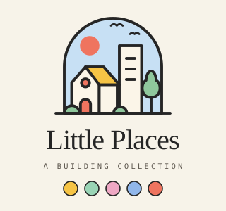
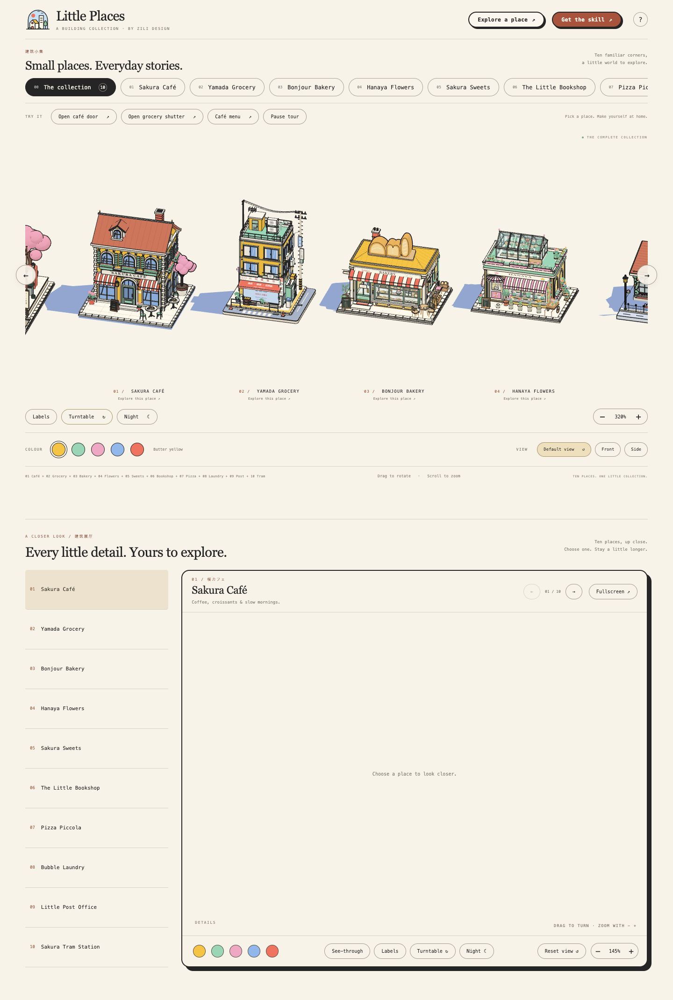

<p align="center"></p>

# Little Places · 建筑小集

**Small places. Everyday stories.** — a building collection by zili design.

Ten little shops and stations, each a real Three.js model you can turn all the way round, look inside and play with: open the doors, post a letter, start a wash, light the pizza oven, catch the tram. They are drawn as if by one illustrator — flat toon colour, dark ink outlines, a warm limited palette, white paving and a soft blue afternoon shadow — and shown together on one page.



## The ten places

| | Place | | Things to try | Link |
| --- | --- | --- | --- | --- |
| 01 | Sakura Café | 桜カフェ | open the door, read the café menu | `/#cafe` |
| 02 | Yamada Grocery | 山田雑貨店 | roll up the shutter, four capsule machines | `/#grocery` |
| 03 | Bonjour Bakery | 焼きたてパン | open the door, hide the pastries, take your bread, see-through | `/#bakery` |
| 04 | Hanaya Flowers | 花屋 | open the door and the glasshouse vent, pick a bouquet, see-through | `/#flowers` |
| 05 | Sakura Sweets | 桜スイーツ | open the door, read the dessert menu | `/#sweets` |
| 06 | The Little Bookshop | 本屋 | open the double door, switch the lights, open the book on the reading roof, see-through | `/#books` |
| 07 | Pizza Piccola | ピッツェリア | open the door, fire up or rest the oven (chimney smoke), open the pizza box, see-through | `/#pizza` |
| 08 | Bubble Laundry | コインランドリー | open the door, start a wash, open the machine door, buy detergent | `/#laundry` |
| 09 | Little Post Office | 郵便局 | open the double door, send a letter, deliver a parcel, see the hall glow at night | `/#post` |
| 10 | Sakura Tram Station | さくら町駅 | pause the tram, open its doors (it stops at the platform), buy a ticket | `/#tram` |

Every place also has five colour schemes, Night mode, labels and a turntable.

## On the page

- **The collection** — the ten places on a slow tour. Drag any one to turn them all together; rest the pointer on a place to pause the tour and bring it a little closer; click it to look closer. The wheel always scrolls the page — zoom with the − / + buttons. Colours, Night, Labels, Turntable and the Default / Front / Side views work across the whole collection or on one place (`/#cafe` … `/#tram`).
- **A closer look** (below the collection, `/#explore/<id>`) — one place at a time in a large display case: its own interactions, a Details list that turns the camera to each detail, See-through, Night, Turntable, Fullscreen and paging. Notes in [web/EXPLORER.md](web/EXPLORER.md).
- **Get the skill** (`/skill.html`) — how to install the Claude skill behind the series, with four places turning by themselves.

## The skill

`little-places-building` is a Claude skill that holds the series' house rules: human-scale proportions, palette and roof contrast, ink lines on hard edges and round shapes, the white paving with one of three street edges, the projected shadow, striped awnings, the chalkboard A-frame, moving parts, interactions, the performance budget and the pitfalls the earlier buildings ran into.

It works on its own. It ships a small kit — the shared helpers and rendering pipeline, a one-building viewer, a generic Playwright check and the Little Post Office as a reference — so you can ask for a new place in an empty folder:

```sh
mkdir -p ~/.claude/skills && curl -fsSL https://raw.githubusercontent.com/StarSharkk/little-places/main/skill/little-places-building.skill -o /tmp/little-places.skill && unzip -oq /tmp/little-places.skill -d ~/.claude/skills
```

Then ask Claude Code something like "Make a little ramen stall in the Little Places style." On Claude.ai, upload [`skill/little-places-building.skill`](skill/little-places-building.skill) under Skills in settings.

Inside this repository Claude uses the repo's own files and adds new places to the collection page. The source is in [`.claude/skills/little-places-building/`](.claude/skills/little-places-building/); `sh skill/build.sh` refreshes the kit from the repo and repackages it (and the copy the site offers for download).

## Run it

Requires Node.js 20.19+ or 22.12+.

```sh
cd web
npm ci
npm run dev        # http://127.0.0.1:5176/
```

```sh
npm run build      # static site in web/dist (index.html and skill.html)
npm run preview    # http://127.0.0.1:4176/
```

Keep `web/` and `buildings/` side by side: the page imports the building modules through Vite aliases.

### Checks

Browser checks use Playwright with Chrome. Start the dev server first, then from `web/`:

| Command | Covers |
| --- | --- |
| `npm run check` | the collection page: views, colours, labels, night, mobile |
| `npm run check:<place>` | one place: `bakery`, `flowers`, `sweets`, `books`, `pizza`, `laundry`, `post`, `tram` |
| `npm run check:navigation` | tabs, gallery paging, deep links |
| `npm run check:rotation` | places never overlap at any camera angle |
| `npm run check:explorer`, `check:explorer-layout` | the closer-look display, its interactions and its fit on screen |

Screenshots and JSON reports are written to `web/screenshots/`.

## Repository

| Path | Contents |
| --- | --- |
| `web/` | The page: collection, explorer, Get the skill, styles and Playwright checks |
| `buildings/01-sakura-cafe/` … `buildings/10-sakura-tram-station/` | One folder per place; each model builds its own scene graph and leaves the renderer, camera and lights to the page |
| `buildings/02-yamada-grocery/src/optimize.js` | The shared rendering pipeline: batching, ink lines and the illustrated shadow |
| `buildings/shared/` | Primitives, ink hull, street edges, props, motion and steam shared by the newer places |
| `.claude/skills/little-places-building/` | The skill source, including its standalone kit |
| `skill/` | The packaged skill and the script that builds it |

## Credits

Designed by zili design. The page layout takes after April Zhu's [Colorfigures](https://april-zhu.com/colorfigures-demo), with its own Little Places identity. Built with [Three.js](https://threejs.org), [Vite](https://vite.dev) and [Playwright](https://playwright.dev).
