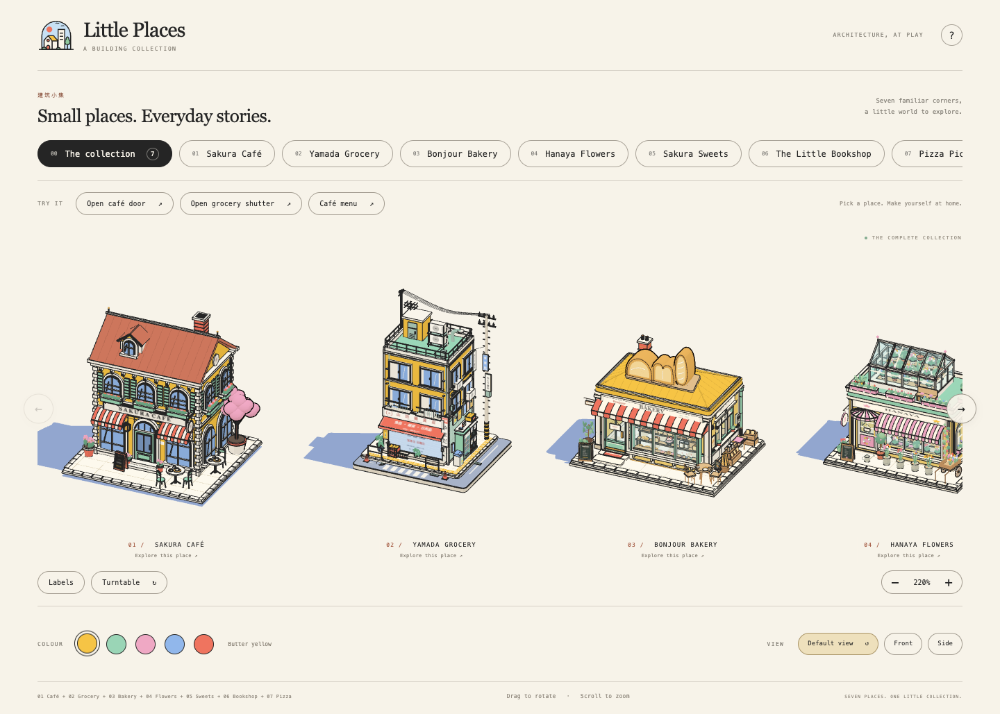

<p align="center"></p>

# Little Places · 建筑小集

An interactive Three.js collection of seven little places: **Sakura Café**, **Yamada Grocery**, **Bonjour Bakery**, **Hanaya Flowers**, **Sakura Sweets**, **The Little Bookshop** and **Pizza Piccola**. All seven buildings are real 3D models, displayed with an orthographic camera, illustrated outlines and a warm, limited colour palette.



## Run the collection

Requires Node.js 20.19+ or 22.12+.

```sh
cd series
npm ci
npm run dev
```

Open http://127.0.0.1:5176/ . Keep all three project directories together: the collection imports the original building modules through Vite aliases.

```sh
npm run build
npm run preview
```

The generated `series/dist` contains the model code and can be served independently.

## Projects

| Directory | Contents |
| --- | --- |
| `series/` | Shared collection interface, overview and individual building views |
| `coffee store/` | Reusable café model, original standalone viewer |
| `grocery/` | Reusable grocery model, texture atlas and original standalone viewer |
| `flower shop/` | Hanaya Flowers: flower shop with a rooftop glasshouse, standalone viewer and checks |
| `coffee store_claude/` | Sakura Sweets: corner dessert shop (the same model can be built as a café with `shop: 'cafe'`), standalone viewer |
| `series/src/bookstore/` | The Little Bookshop: mint bookstore with a furnished interior, side deck and rooftop reading terrace |
| `series/src/pizza/` | Pizza Piccola: brick pizzeria with a wood-fired oven, takeaway window, fenced terrace, delivery scooter and a giant rooftop slice (built with the `little-places-building` skill) |

The collection supports drag rotation, smooth zoom, five colour presets, labels, turntable, front/side views, café door and menu interactions, and a grocery shutter. The grocery retains its four capsule machines and corrected poster spacing. Bonjour Bakery has a hipped roof with a louvred lantern, a real pastry display, door animation, a roof-and-wall cutaway, pastry visibility and a reversible takeaway-bag interaction (`/#bakery`). Hanaya Flowers adds a door, a glasshouse vent, a bouquet pickup and a cutaway (`/#flowers`). Sakura Sweets has a door and a dessert menu (`/#sweets`). The Little Bookshop has a double door, interior lights, a cutaway, an openable book on the deck lectern and six labels (`/#books`, checked by `npm run check:books`). Pizza Piccola has a door, an oven fire you can light or rest (with chimney smoke), a takeaway pizza box that opens, a cutaway and six labels (`/#pizza`, `npm run check:pizza`). Keep all project folders side by side: the collection imports them through Vite aliases.

## Verification

Production build and local Chrome/Playwright checks passed for desktop (1440 × 1000) and mobile (390 × 844) viewports. Functional checks, screenshots and measured rendering statistics are recorded in [series/VERIFICATION.md](series/VERIFICATION.md) and [series/screenshots/verification.json](series/screenshots/verification.json).

To rerun browser checks, install Chrome, start `npm run preview` in `series`, then run:

```sh
cd series
BASE_URL=http://127.0.0.1:4176/ npm run check
```

Mobile checks use browser viewport emulation; physical mobile devices and M1 frame rates have not been measured.

## Interface inspiration

The collection interface references April Zhu's [Colorfigures](https://april-zhu.com/colorfigures-demo), with an original Little Places identity and layout.
