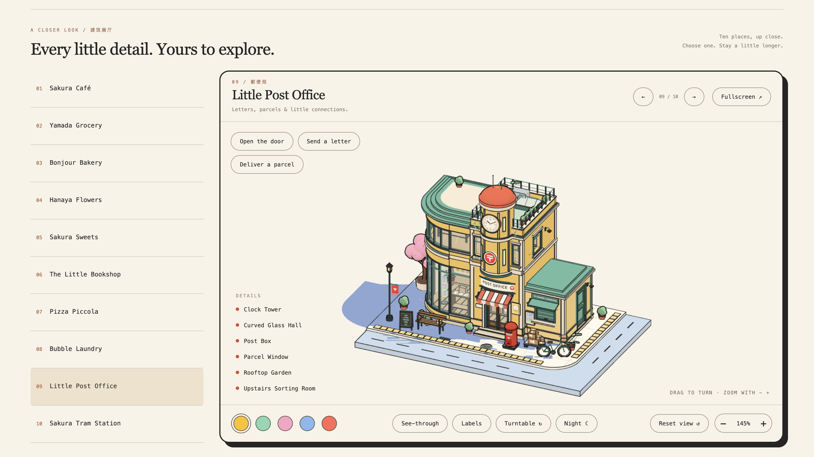
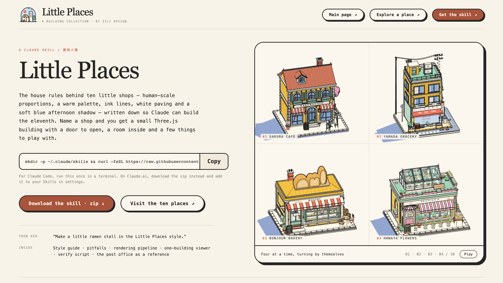

# Little Places · 建筑小集

[English](README.md) · 中文

**Small places. Everyday stories.** —— zili design 的一组小建筑。

十个小店和车站，每一个都是真正的 Three.js 模型：可以转一整圈、看进屋里，还能动手玩——开门、投信、洗衣服、点燃披萨炉、等电车进站。它们像出自同一位插画师之手：平涂的卡通色、深色墨线、温暖克制的配色、白色铺地和一片柔和的蓝色午后投影，全部放在同一个网页上展示。


## 十个地方

| | 地方 | | 可以玩什么 | 链接 |
| --- | --- | --- | --- | --- |
| 01 | Sakura Café | 桜カフェ | 开门、看咖啡菜单 | `/#cafe` |
| 02 | Yamada Grocery | 山田雑貨店 | 拉起卷帘门、四台扭蛋机 | `/#grocery` |
| 03 | Bonjour Bakery | 焼きたてパン | 开门、收起面包、带走你的面包、透视 | `/#bakery` |
| 04 | Hanaya Flowers | 花屋 | 开门、打开温室天窗、挑一束花、透视 | `/#flowers` |
| 05 | Sakura Sweets | 桜スイーツ | 开门、看甜品菜单 | `/#sweets` |
| 06 | The Little Bookshop | 本屋 | 打开双开门、开关灯、翻开屋顶阅读台上的书、透视 | `/#books` |
| 07 | Pizza Piccola | ピッツェリア | 开门、点燃或熄灭烤炉（烟囱冒烟）、打开披萨盒、透视 | `/#pizza` |
| 08 | Bubble Laundry | コインランドリー | 开门、开始洗衣、打开机门、买洗衣液 | `/#laundry` |
| 09 | Little Post Office | 郵便局 | 打开双开门、投一封信、寄一个包裹、夜里玻璃大厅亮起来 | `/#post` |
| 10 | Sakura Tram Station | さくら町駅 | 暂停电车、打开车门（电车会在站台停稳）、买一张车票 | `/#tram` |

每个地方都有五套配色、夜间模式、标签和自动旋转。

## 网页上有什么

- **建筑合集** —— 十个地方慢慢巡游。拖动其中任意一栋，所有建筑一起转；鼠标停在某一栋上，巡游暂停，这一栋稍微放大；点击它可以看近景。滚轮永远只滚动页面，缩放用 − / + 按钮。配色、夜间、标签、自动旋转和默认 / 正面 / 侧面视角，既可以作用于整个合集，也可以只看一栋（`/#cafe` … `/#tram`）。
- **近看展厅**（合集下方，`/#explore/<id>`）—— 一次只看一栋，放在一个大展示框里：它自己的互动、一个会把镜头转到各处细节的 Details 列表、透视、夜间、自动旋转、全屏和翻页。说明见 [web/EXPLORER.md](web/EXPLORER.md)。
- **Get the skill**（`/skill.html`）—— 介绍这套建筑背后的 Claude skill 如何安装，右侧四栋建筑一组自己转动展示。





## Skill

`little-places-building` 是一个 Claude skill，里面写着这套建筑的规矩：人体尺度的比例、配色和屋顶冷暖对比、硬边和圆形物体上的墨线、白色铺地和三种街边收边、投影、条纹遮阳篷、A 字黑板、可动部件、互动、性能预算，以及前面几栋建筑踩过的坑。

它可以独立使用。skill 里附带一个小工具包——共用零件和渲染管线、一个单建筑查看器、一个通用的 Playwright 检查脚本，以及作为参考的 Little Post Office——所以在一个空文件夹里也能让 Claude 新做一栋：

```sh
mkdir -p ~/.claude/skills && curl -fsSL https://raw.githubusercontent.com/StarSharkk/little-places/main/skill/little-places-building.skill -o /tmp/little-places.skill && unzip -oq /tmp/little-places.skill -d ~/.claude/skills
```

然后在 Claude Code 里说类似"做一个 Little Places 风格的小拉面摊"就可以了。在 Claude.ai 上，把 [`skill/little-places-building.skill`](skill/little-places-building.skill) 上传到设置里的 Skills。

在这个仓库里使用时，Claude 会直接用仓库里的文件，并把新建筑加进合集页面。skill 源文件在 [`.claude/skills/little-places-building/`](.claude/skills/little-places-building/)；运行 `sh skill/build.sh` 会从仓库更新工具包并重新打包（网站上提供下载的那份也会一起更新）。

## 本地运行

需要 Node.js 20.19+ 或 22.12+。

```sh
cd web
npm ci
npm run dev        # http://127.0.0.1:5176/
```

```sh
npm run build      # 静态网站输出到 web/dist（index.html 和 skill.html）
npm run preview    # http://127.0.0.1:4176/
```

`web/` 和 `buildings/` 要放在一起：网页通过 Vite 别名引用各个建筑模块。

### 检查

浏览器检查使用 Playwright 和 Chrome。先启动开发服务器，然后在 `web/` 里运行：

| 命令 | 检查内容 |
| --- | --- |
| `npm run check` | 合集页面：视角、配色、标签、夜间、手机版 |
| `npm run check:<地方>` | 单个地方：`bakery`、`flowers`、`sweets`、`books`、`pizza`、`laundry`、`post`、`tram` |
| `npm run check:navigation` | 标签页、合集翻页、直达链接 |
| `npm run check:rotation` | 任何视角下建筑都不会互相重叠 |
| `npm run check:explorer`、`check:explorer-layout` | 近看展厅、它的互动以及在屏幕上的排版 |

截图和 JSON 报告保存在 `web/screenshots/`。

## 仓库结构

| 路径 | 内容 |
| --- | --- |
| `web/` | 网页：合集、近看展厅、Get the skill、样式和 Playwright 检查 |
| `buildings/01-sakura-cafe/` … `buildings/10-sakura-tram-station/` | 每个地方一个文件夹；模型只搭建自己的场景，渲染器、相机和灯光交给网页 |
| `buildings/02-yamada-grocery/src/optimize.js` | 共用渲染管线：合批、墨线和插画式投影 |
| `buildings/shared/` | 较新的几栋共用的基础几何、墨线外壳、街边收边、街道小物、动画和蒸汽 |
| `.claude/skills/little-places-building/` | skill 源文件，包括独立使用的工具包 |
| `skill/` | 打包好的 skill 和打包脚本 |

## 致谢

由 zili design 设计。页面排版参考了 April Zhu 的 [Colorfigures](https://april-zhu.com/colorfigures-demo)，并使用了 Little Places 自己的视觉风格。使用 [Three.js](https://threejs.org)、[Vite](https://vite.dev) 和 [Playwright](https://playwright.dev) 制作。
